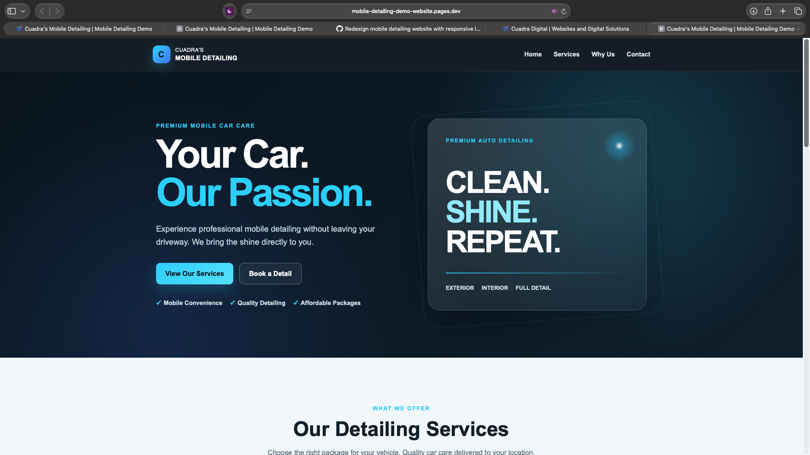

# Cuadra's Mobile Detailing

A modern, responsive website developed for a fictional mobile auto-detailing business.

**[View Live Website](https://mobile-detailing-demo-website.pages.dev/)**

## Project Preview



## Project Overview

Cuadra's Mobile Detailing is a frontend web development and quality assurance portfolio project.

The goal was to design, build, test, and deploy a professional-looking website for a fictional mobile detailing business.

The website allows visitors to explore detailing services, compare starting prices, learn about the booking process, and access contact information.

The project also demonstrates responsive design, accessibility considerations, manual testing, version control, and production deployment.

## Technologies Used

- **HTML5** — Semantic page structure and content
- **CSS3** — Responsive layouts, styling, gradients, and media queries
- **JavaScript** — Dynamic copyright year and navigation behavior
- **Git & GitHub** — Version control and feature branch workflow
- **Cloudflare Pages** — Website hosting and deployment
- **VS Code** — Development environment

## Key Features

### Responsive Design
- Desktop and mobile-friendly layouts
- Responsive navigation and hero section
- CSS Grid and Flexbox layouts
- Mobile layouts tested at 393px and 320px
- No horizontal overflow at tested mobile widths

### Services and Pricing
- Exterior detailing service card
- Interior detailing service card
- Full detailing service card
- Starting prices displayed for each service
- Consistent card spacing and alignment

### User Experience
- Smooth scrolling between sections
- Clear calls to action
- Benefits and service process sections
- Click-to-call contact link using demonstration contact information
- Mobile-friendly navigation

### Accessibility
- Keyboard navigation support
- Visible keyboard focus states
- Descriptive page title and metadata
- Structured headings and navigation

### JavaScript Functionality
- Automatically updated copyright year
- Navigation state updates based on page position

## Run Locally

1. Clone the repository:

   ```bash
   git clone https://github.com/Walter1215/mobile-detailing-demo-website.git
   ```

2. Open the project directory:

   ```bash
   cd mobile-detailing-demo-website
   ```

3. Open the project in Visual Studio Code.

4. Launch `index.html` using the Live Server extension.

No package installation or build process is required.

## Quality Assurance

Manual testing was performed to evaluate website functionality, responsiveness, and usability.

### Testing Coverage

| Test Area | Result |
|---|---|
| Desktop layout | Passed |
| Mobile layout at 393px | Passed |
| Mobile layout at 320px | Passed |
| Horizontal overflow at tested widths | Passed |
| Navigation links | Passed |
| Smooth scrolling | Passed |
| Contact button | Passed |
| Footer copyright year | Passed |
| Keyboard navigation | Passed |
| Visible keyboard focus | Passed |
| Service card alignment | Passed |

Testing was performed manually. Automated testing and comprehensive cross-browser compatibility testing are not included in the current test coverage.

### QA Documentation

The repository contains supporting QA documentation:

- [QA Case Study](qa/QA_CASE_STUDY.md)
- [Manual Test Cases](qa/TEST_CASES.md)
- [Bug Reports](qa/BUG_REPORTS.md)
- [Test Summary Report](qa/TEST_SUMMARY.md)

These documents demonstrate the testing process, identified issues, verification activities, and recorded results.

## Development Workflow

The website was developed using a Git-based workflow.

1. Built the initial HTML, CSS, and JavaScript implementation.
2. Created a dedicated `detailing-redesign` branch.
3. Redesigned the website for desktop and mobile devices.
4. Performed manual responsive and functional testing.
5. Committed and pushed changes to GitHub.
6. Created and merged a pull request into `main`.
7. Deployed the updated website using Cloudflare Pages.

## Future Improvements

- Add a functional appointment request form
- Implement backend APIs for appointment management
- Store customer requests in a database
- Add automated end-to-end tests using Playwright
- Expand accessibility testing
- Test additional browsers and screen sizes

## Disclaimer

This website is a fictional business demonstration created for educational and portfolio purposes.

Service prices and contact information are examples. No actual detailing services or online booking system are provided.